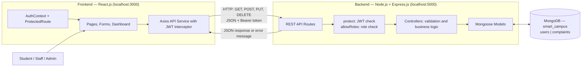
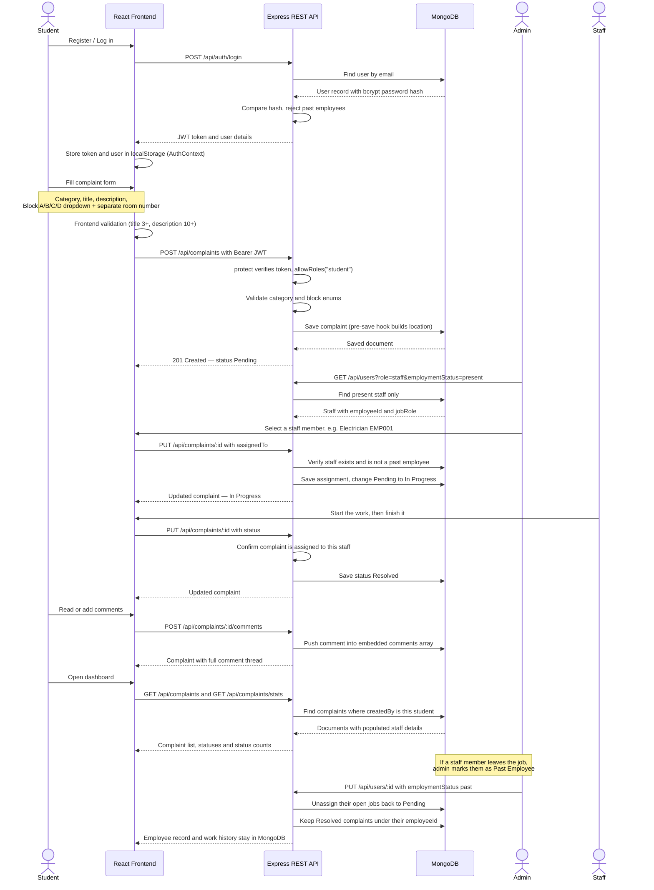
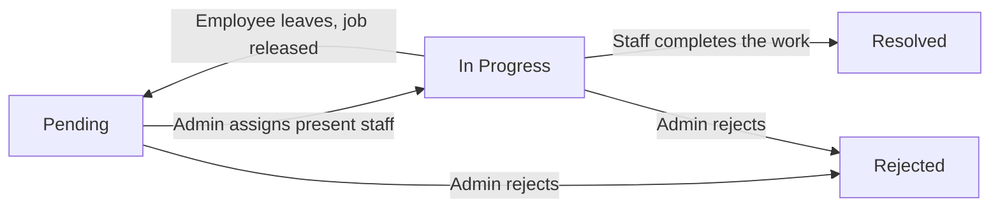
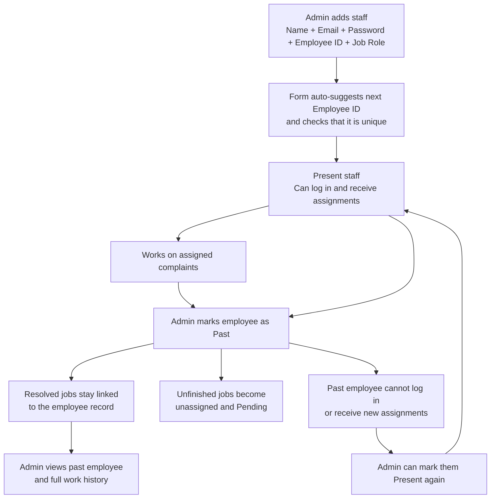
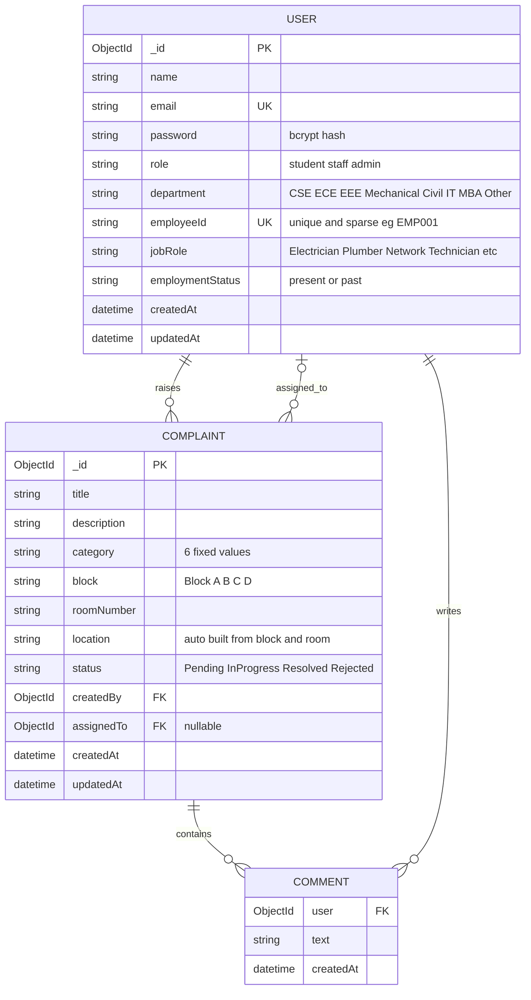

# Smart Campus — Architecture and Flow Diagrams

## 1. Project Overview

**Smart Campus Complaint and Maintenance Management System** allows students to report campus maintenance problems. An admin assigns complaints to present maintenance staff, and staff update the work status. The system also keeps past employees and their completed work permanently in the database.

**Technology stack:** React.js → Node.js + Express.js → MongoDB

**Three user roles:** Student (raises and tracks complaints), Admin (assigns staff, changes status, manages staff records), Staff (works on assigned complaints only).

---

## 2. System Architecture

### What each layer does

| Layer | Responsibility |
|---|---|
| **React frontend** | Shows login, dashboard, complaint form, complaint details and Manage Staff pages. |
| **AuthContext / ProtectedRoute** | Keeps the logged-in user, stores the token in localStorage, and blocks pages for wrong roles. |
| **Axios service** | Sends all requests to the Express REST APIs and automatically attaches the login token. |
| **Express backend** | Receives requests, verifies authentication and role, validates input, applies business rules. |
| **Mongoose models** | Define the User and Complaint schemas and perform all MongoDB operations. |
| **MongoDB** | Permanently stores users, employees, complaints and comments. |

During development, Vite runs the frontend on port **3000** and forwards every `/api` request to the Express backend on port **5000** through the proxy in `vite.config.js`. The backend reads `PORT`, `MONGO_URI` and `JWT_SECRET` from its `.env` file.

---

## 3. Complaint Flow

**Status path:** `Pending → In Progress → Resolved` (admin may also set `Rejected`)

**Example:** A student reports a broken fan in **Block A, Room 204**. The backend stores `block = "Block A"`, `roomNumber = "204"` and auto-builds `location = "Block A - Room 204"`. The admin opens the complaint, and the assign dropdown lists only present staff — he selects **Ravi Kumar — Electrician (EMP001)**. The status changes automatically from **Pending** to **In Progress**. Ravi logs in, sees only his assigned jobs, clicks **Working On It** and later **Mark Resolved**. The student sees the updated status on his dashboard and detail page.

If Ravi later leaves the college, the admin clicks **Mark as Past** in Manage Staff. Ravi can no longer log in, his unfinished jobs return to **Pending**, but his Employee ID **EMP001** and all resolved complaints remain in MongoDB and can be viewed any time from his **Work done** history.

---

## 4. Complaint Status Flow

- A newly created complaint always starts as **Pending**.
- A student can **edit or delete only their own Pending** complaint. Once work starts it is locked.
- When an admin assigns a **present** staff member to a Pending complaint, it becomes **In Progress** automatically.
- The assigned staff member can click **Working On It** and then **Mark Resolved**. The backend rejects the request with `403` if the complaint is not assigned to that employee.
- The admin can manually set any status through the status buttons, including **Rejected**.
- If an assigned employee is marked as a **past employee**, their unfinished (Pending or In Progress) jobs are released back to **Pending** and become unassigned, so another present employee can take them. Resolved jobs are never touched.

---

## 5. Staff and Past Employee Flow

Every staff member has a **unique Employee ID** (for example `EMP001`), a **job role** selected from a dropdown (Electrician, Plumber, Network Technician, Housekeeping, Carpenter, Painter, AC Technician, Gardener, Mason, General) and an **employment status** (`present` or `past`).

**Important rules**

- Past employees are **never deleted**. Their completed complaints stay linked through the complaint's `assignedTo` field, along with their name, Employee ID and job role.
- Admin opens **Manage Staff → Past Employees**, selects a card and views the **Work done** table for that Employee ID.
- Marking an employee as **Past** immediately blocks login (`403`) and releases their open jobs to **Pending**.
- Admin can **Mark as Present** again to reactivate a former employee, restoring their login and assignment eligibility.
- Admin **cannot delete** a staff member who has complaints assigned. The API returns a message asking to mark them Past instead, so work history is never lost.
- More staff can be added at any time in the future. `GET /api/users/next-id` suggests the next available Employee ID, and the database enforces uniqueness.

---

## 6. Database Design

MongoDB has **two collections**: `users` and `complaints`. Comments are stored **inside the complaint document** as an embedded array, not in a separate collection. The `COMMENT` box above only shows their logical structure.

- `createdBy` refers to the student who raised the complaint.
- `assignedTo` refers to the staff member handling it, and stays filled even after that employee becomes a past employee.
- Mongoose `populate()` retrieves the referenced person's name, Employee ID, job role and employment status for display.
- `block` and `roomNumber` are stored as separate fields because the student selects the block from a dropdown and types the room number. A display value such as **Block A - Room 204** is generated automatically in a `pre("save")` hook.
- `employeeId` uses `unique: true, sparse: true` — unique among employees, while students without an ID do not conflict.
- `{ timestamps: true }` adds `createdAt` and `updatedAt` automatically.

---

## 7. Main REST APIs and CRUD

| Method | Endpoint | Access | Purpose |
|---|---|---|---|
| `POST` | `/api/auth/register` | Public | Register a student |
| `POST` | `/api/auth/login` | Public | Log in and receive a JWT |
| `GET` | `/api/auth/profile` | Logged in | Get the logged-in user's details |
| `GET` | `/api/complaints` | Logged in | Read complaints filtered by role; supports `?status=&category=&search=` |
| `GET` | `/api/complaints/stats` | Logged in | Read the count of complaints in each status |
| `GET` | `/api/complaints/:id` | Logged in | Read one complaint with staff and comment details |
| `POST` | `/api/complaints` | Student | Create a complaint |
| `PUT` | `/api/complaints/:id` | Student / Staff / Admin | Edit own pending complaint, assign staff, or change status |
| `DELETE` | `/api/complaints/:id` | Student own pending / Admin | Delete a permitted complaint |
| `POST` | `/api/complaints/:id/comments` | Logged in | Add a comment |
| `GET` | `/api/users` | Admin | View staff using `?role=staff&employmentStatus=present` or `past` |
| `GET` | `/api/users/next-id` | Admin | Suggest the next available Employee ID |
| `POST` | `/api/users` | Admin | Add a staff member or another admin |
| `GET` | `/api/users/:id/work` | Admin | View one employee's full work history |
| `PUT` | `/api/users/:id` | Admin | Change job role, department, or present/past status |
| `DELETE` | `/api/users/:id` | Admin | Delete a user who has no assigned work |

**CRUD mapping:** Create = `POST`, Read = `GET`, Update = `PUT`, Delete = `DELETE`.

**Role-based reading:** the same `GET /api/complaints` endpoint returns different data — a student sees only their own complaints, a staff member sees only complaints assigned to them, and the admin sees everything. This filtering happens on the server, not by hiding buttons in the UI.

---

## 8. Authentication, Validation and Error Handling

1. Passwords are hashed with **bcrypt** in a Mongoose `pre("save")` hook, so plain passwords are never stored.
2. Login returns a **JWT** signed with `JWT_SECRET`, valid for 7 days. Protected requests send it as `Authorization: Bearer <token>`.
3. An **Axios request interceptor** attaches that token automatically to every API call.
4. `protect` middleware verifies the token and loads the user; `allowRoles(...)` middleware checks the role.
5. **ProtectedRoute** in React redirects non-logged-in users to `/login` and wrong roles back to the dashboard.
6. The frontend validates forms first, and the backend validates the same data again before saving — never trusting the browser.
7. Mongoose schemas restrict fields such as `category`, `block`, `status`, `role`, `department` and `jobRole` to valid values using `enum`, and enforce `required`, `minlength` and `unique`.
8. Past employees cannot log in and cannot be assigned new work.
9. All API errors return the same JSON shape `{ "message": "..." }`, which the frontend displays directly using a `getError()` helper.
10. A central `errorHandler` middleware converts internal errors into clean responses: Mongoose `ValidationError` → first field message, `CastError` → "Invalid ID", duplicate key `11000` → "Email already exists", anything else → generic server error. A `notFound` middleware handles unknown routes.

| Status | Meaning |
|---|---|
| `201` | Record created successfully |
| `400` | Missing or invalid input |
| `401` | Not logged in, or invalid/expired token |
| `403` | Logged in but not allowed to perform this action |
| `404` | Record or route not found |
| `500` | Unexpected server error |

**Overall request flow:** **React UI → Axios request with JWT → Express route → protect / allowRoles middleware → Controller validation → Mongoose model → MongoDB → JSON response → React UI update.**

---

