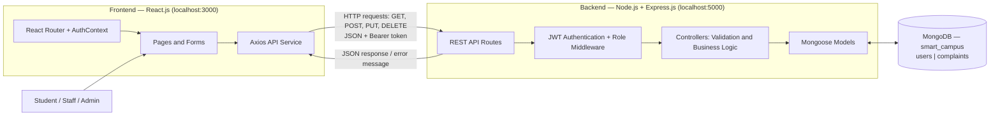
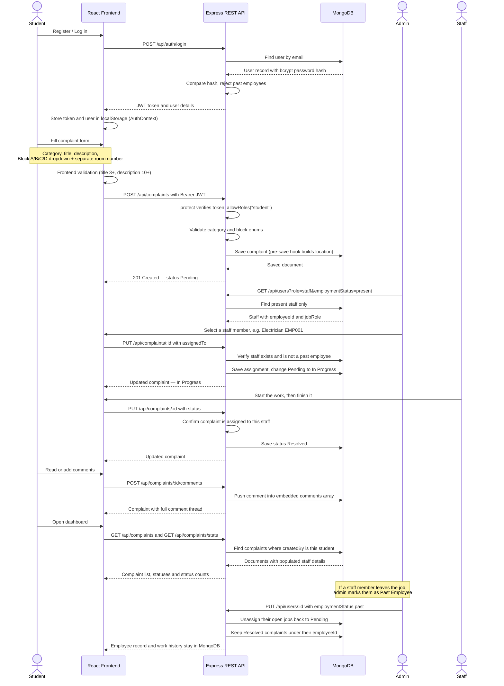
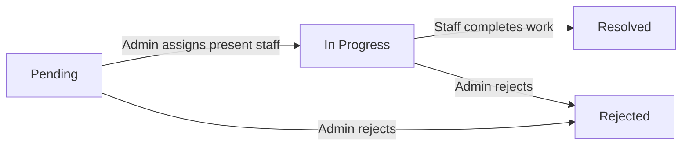
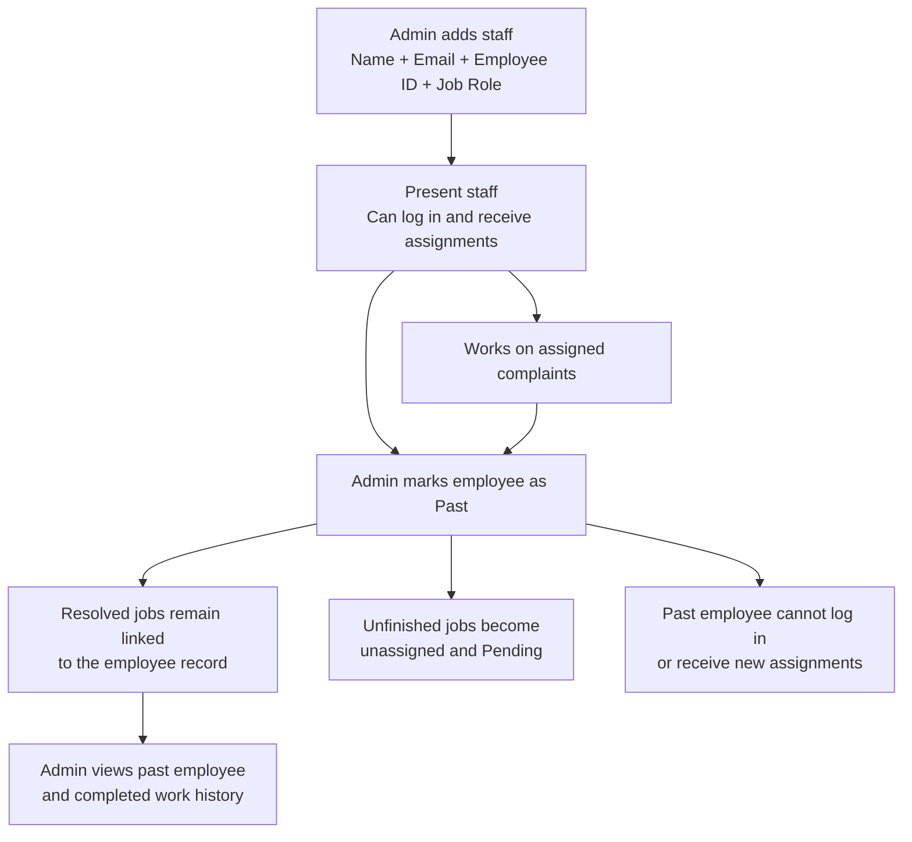
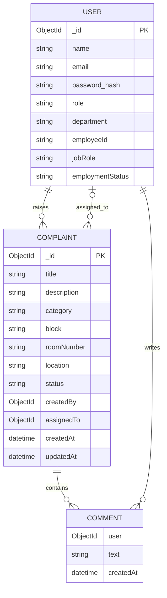

# Smart Campus — Architecture and Flow Diagrams

## 1. Project Overview

**Smart Campus Complaint and Maintenance Management System** allows students to report campus maintenance problems. An admin assigns complaints to present maintenance staff, and staff update the work status. The system also keeps past employees and their completed work in the database.

**Technology stack:** React.js → Node.js + Express.js → MongoDB

---

## 2. System Architecture

### What each layer does

| Layer | Responsibility |
|---|---|
| **React frontend** | Shows pages, forms, dashboard, complaint details and staff details. |
| **Axios** | Sends requests to the Express REST APIs. It includes the login token in protected requests. |
| **Express backend** | Receives requests, checks authentication and roles, validates input and applies business rules. |
| **Mongoose** | Defines the User and Complaint schemas and performs MongoDB operations. |
| **MongoDB** | Permanently stores users, employees, complaints and comments. |

During development, Vite runs the frontend on port **3000** and forwards `/api` requests to the Express backend on port **5000**. The backend reads the MongoDB connection string from its `.env` file.

---

## 3. Complaint Flow

**Status path:** `Pending → In Progress → Resolved` (admin may also set `Rejected`)

**Example:** A student reports a broken fan in **Block A, Room 204**. The backend stores `block = "Block A"`, `roomNumber = "204"` and auto-builds `location = "Block A - Room 204"`. The admin opens the complaint, and the assign dropdown lists only present staff — he selects **Ravi Kumar — Electrician (EMP001)**. The status changes automatically from **Pending** to **In Progress**. Ravi logs in, sees only his assigned jobs, clicks **Working On It** and later **Mark Resolved**. The student sees the updated status on his dashboard and detail page.

If Ravi later leaves the college, the admin clicks **Mark as Past** in Manage Staff. Ravi can no longer log in, his unfinished jobs return to **Pending**, but his Employee ID **EMP001** and all resolved complaints remain in MongoDB and can be viewed any time from his **Work done** history.

## 4. Complaint Status Flow

- A newly created complaint starts as **Pending**.
- Students can edit or delete **their own Pending** complaints.
- When an admin assigns present staff to a Pending complaint, it becomes **In Progress**.
- Assigned staff can update their work to **Resolved**.
- The admin can also manually change a complaint's status, including **Rejected**.

---

## 5. Staff and Past Employee Flow

Each staff member has a **unique Employee ID** (for example, `EMP001`), a job role (Electrician, Plumber, Network Technician, etc.) and an employment status (`present` or `past`).

**Important:** Past employees are **not deleted**. Their completed complaints remain linked through the complaint's `assignedTo` field. The admin can open **Manage Staff → Past Employees**, select an employee and view their work history.

When a staff member is marked as past, unfinished jobs are returned to **Pending** so another present employee can be assigned.

The admin can also add more staff in the future. The form suggests the next available Employee ID and checks that the ID is unique.

---

## 6. Database Design

MongoDB has **two main collections**: `users` and `complaints`. Comments are stored **inside complaint documents**, not in a separate collection. The `COMMENT` box above represents their logical structure.

- `createdBy` refers to the student who raised a complaint.
- `assignedTo` refers to the staff member handling it.
- Mongoose `populate()` retrieves the referenced person's name, Employee ID and job role for display.
- `block` and `roomNumber` are stored separately. A display location such as **Block A - Room 204** is generated from them.

---

## 7. Main REST APIs and CRUD

| Method | Endpoint | Purpose |
|---|---|---|
| `POST` | `/api/auth/register` | Register a student |
| `POST` | `/api/auth/login` | Log in and receive a JWT |
| `GET` | `/api/complaints` | Read complaints based on the user's role |
| `GET` | `/api/complaints/:id` | Read complaint details |
| `POST` | `/api/complaints` | Create a complaint |
| `PUT` | `/api/complaints/:id` | Edit, assign or update status |
| `DELETE` | `/api/complaints/:id` | Delete a permitted complaint |
| `POST` | `/api/complaints/:id/comments` | Add a comment |
| `GET` | `/api/users` | Admin views present or past staff |
| `POST` | `/api/users` | Admin adds staff |
| `PUT` | `/api/users/:id` | Admin changes staff employment status |
| `GET` | `/api/users/:id/work` | Admin views an employee's work history |
| `GET` | `/api/users/next-id` | Suggest the next Employee ID |

**CRUD mapping:** Create = `POST`, Read = `GET`, Update = `PUT`, Delete = `DELETE`.

---

## 8. Authentication, Validation and Error Handling

1. Passwords are hashed using **bcrypt** before they are stored.
2. Login returns a **JWT**. Protected API requests send it as a Bearer token.
3. Express middleware verifies the token and checks the user's role.
4. The frontend validates forms, and the backend validates data again before saving it.
5. Mongoose schemas restrict fields such as block, category, status and job role to valid choices.
6. Past employees cannot log in or receive new assignments.
7. API errors return JSON messages with appropriate status codes:

| Status | Meaning |
|---|---|
| `400` | Missing or invalid input |
| `401` | Not logged in or invalid token |
| `403` | User is not allowed to perform the action |
| `404` | Record or route not found |
| `500` | Unexpected server error |

**Overall flow:** **React UI → Axios request → Express route → Authentication/role middleware → Controller validation → Mongoose model → MongoDB → JSON response → React UI.**
